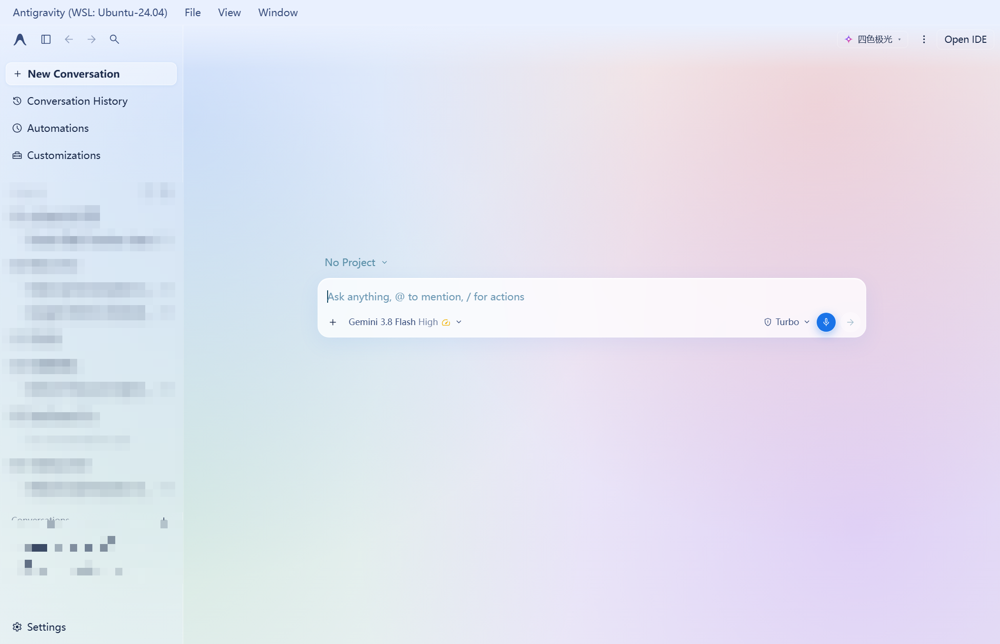
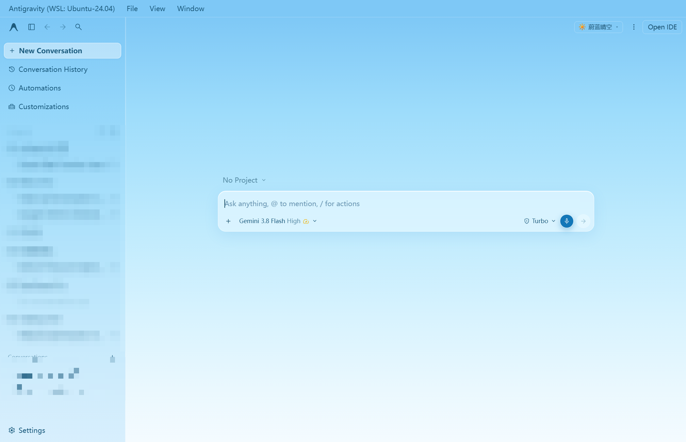
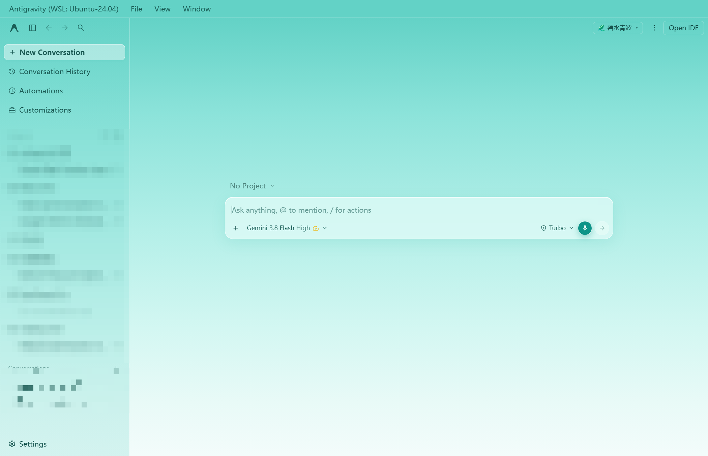
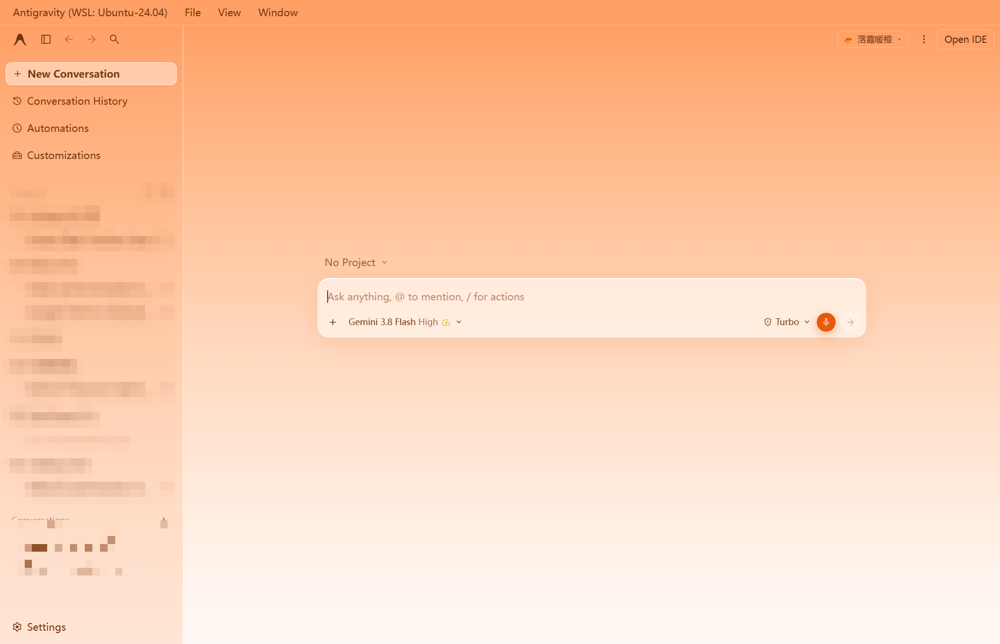
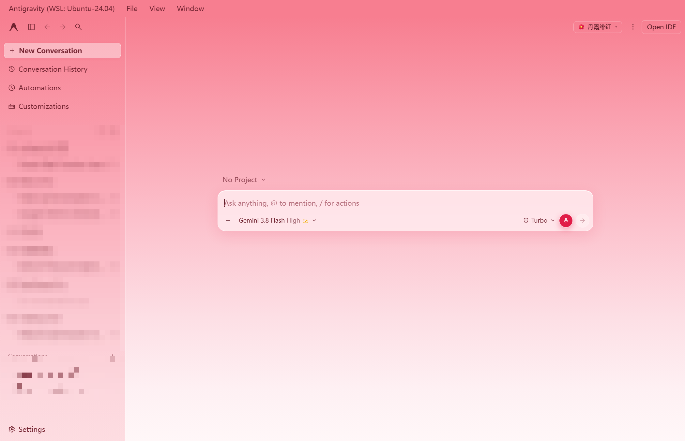
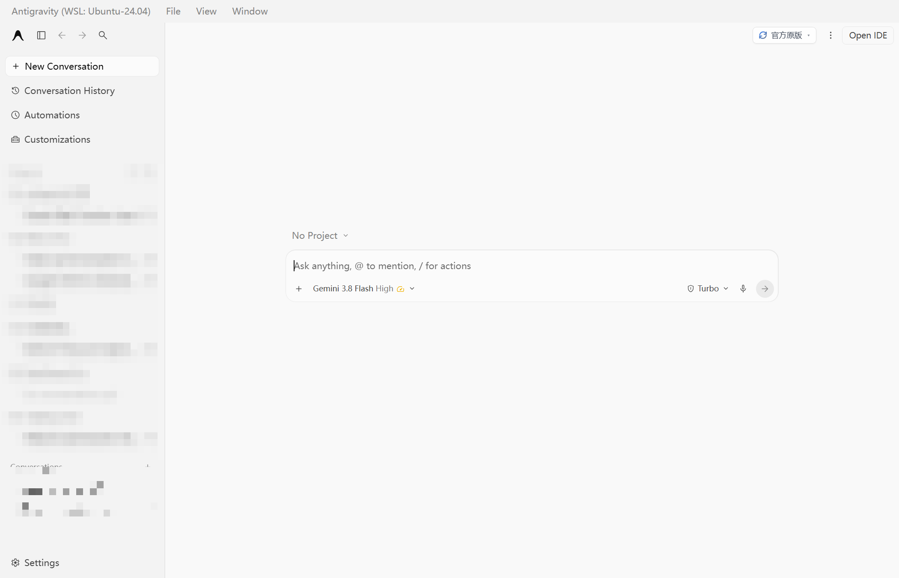

# 🌈 Antigravity Custom Themes

为 [Google Antigravity](https://antigravity.google/) 打造的**即装即用浅色主题套件**。下载发行包后双击 `install.bat` 即可完成全部安装，右上角胶囊菜单毫秒级免刷新切换主题，重启自动恢复上次选择。

[](https://github.com/MCRYII/antigravity-custom-themes/releases/latest)

---

## ✨ 特性

- 🎨 **5 款精调浅色主题 + 官方原版**：低饱和度护眼渐变，原生标题栏无缝零色差
- ⚡ **免刷新即时换肤**：点击右上角胶囊下拉菜单，零白屏、零等待
- 💾 **主题记忆**：基于客户端原生持久化存储，关闭重启后自动恢复上次主题
- 🖼 **看图体验优化**：图片查看器的顶部操作坞与底部缩放条统一为毛玻璃胶囊（官方原版下告别死黑药丸），右上角系统按钮区与遮罩同色贴合
- 📜 **精致滚动条**：5px 半透明胶囊常态，悬停渐变为主题色流光
- 🔁 **幂等安装 / 一键卸载**：脚本可重复运行，卸载完整还原原生客户端

---

## 🚀 一键安装

1. 从 [**Releases · 最新发行版**](https://github.com/MCRYII/antigravity-custom-themes/releases/latest) 下载 `antigravity-custom-themes-v1.0.0.zip` 并解压到任意目录
2. **双击 `install.bat`**（需已安装官方 Antigravity；若客户端正在运行，脚本会提示自动关闭）
3. 启动 Antigravity，点击**右上角胶囊按钮**切换主题，即刻生效

> 脚本会自动完成：备份原生 `app.asar` → 注入约 20 行主题加载钩子（含完整性校验重算与自检）→ 将主题引擎分发到客户端主题目录。全程无需手动操作。

---

## 🖼 主题展示

### 🌈 四色极光（默认主题）
融合 Gemini 标志性四色的极光渐变底色，低饱和度护眼设计。



### ☀️ 蔚蓝晴空
宁静清澈的天蓝色系，纯净现代的极简开发体验。



### 🍃 碧水青波
清新薄荷水波与碧青色调，温润透亮，护眼舒适。



### 🌅 落霞暖橙
温暖落日晚霞与暖阳橙色调，带来柔和的心流沉浸感。



### 🌺 丹霞绯红
优雅海棠山茶柔粉绯红，高雅明亮，绝不刺眼。



### ⚙️ 官方原版
一键回到原生外观。浅色模式下看图胶囊同样升级为浅灰毛玻璃；选择原版时脚本对客户端零干预。



---

## 🌙 关于深色模式（v1 说明）

本套件目前为 **v1，仅提供浅色主题**。深色模式尚未制作自定义皮肤——选择「官方原版」时，深浅色完全跟随系统原生外观，其余主题请配合系统浅色模式使用。深色主题已列入计划。

---

## 🔄 客户端更新后

Antigravity 自动更新会清空主题目录并还原 `app.asar`。更新完成后**重新运行一次 `install.bat`** 即可恢复（脚本幂等，安全无副作用）。

---

## 🗑 卸载

双击 `uninstall.bat`：自动从备份还原原生 `app.asar` 并删除全部主题文件，重启客户端即恢复原版外观。

---

## 📁 文件结构

```text
├── install.bat       # 一键安装入口（双击运行）
├── install.ps1       # 安装核心：asar 备份 / 钩子注入 / 文件分发 / 自检
├── uninstall.bat     # 一键卸载入口
├── current.js        # 主题引擎（内置全部主题样式与切换器，运行时加载）
├── current.css       # 主题无关的通用规则（看图胶囊结构等）
├── assets/           # 主题预览截图
└── README.md
```

---

## ❓ 常见问题

**安装后没有效果？**
完全退出 Antigravity（含托盘）后重新启动。主题在页面加载时注入，运行中的旧页面不会自动应用。

**切换主题后重启又变回默认？**
v1.1 起主题选择通过客户端原生持久化存储记忆，重启自动恢复。若遇到此问题请确认使用的是最新版 `current.js` 并重新运行 `install.bat`。

**可以只恢复原版吗？**
可以，在下拉菜单选择「官方原版」即可；若想彻底移除主题系统，运行 `uninstall.bat`。

---

## ⚙️ 工作原理（简述）

安装脚本在 `app.asar` 内 `dist/utils.js` 的窗口创建流程中注入一个 `dom-ready` 监听（约 20 行，只读不改任何业务代码），客户端每次加载页面时按 `resources/custom-theme` → `%APPDATA%\Antigravity\custom-theme` 顺序加载 `current.css` 与 `current.js`。主题引擎随后注入样式、挂载右上角切换器，并通过 `setTitleBarOverlay` 让原生标题栏与主题底色像素级对齐。主题偏好写入客户端自带的键值存储（`app_storage.json`），与缩放级别等原生设置同库，跨重启可靠恢复。
