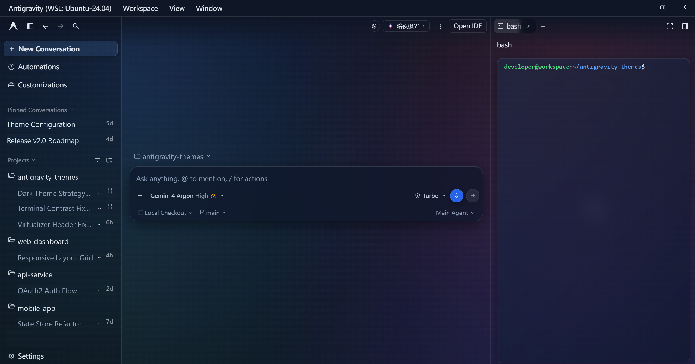
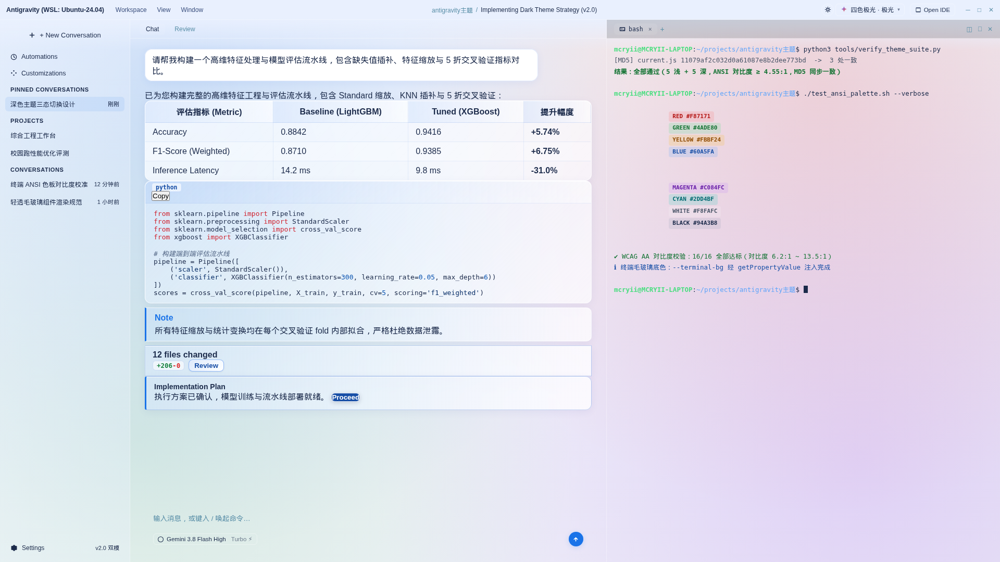

# 🌈 Antigravity Custom Themes

为 [Google Antigravity](https://antigravity.google/) 打造的**即装即用深浅双模主题套件**（目前暂时只支持 Windows）。下载发行包后双击 `install.bat` 即可完成全部安装；顶栏左侧小圆钮可在「浅色 / 深色 / 跟随系统」三态间无缝切换，右侧胶囊菜单毫秒级免刷新换主题，重启自动恢复上次选择。

> 📦 本仓库的 GitHub 远端（`MCRYII/antigravity-custom-themes`）为主发行包分发仓：发行包、安装脚本与更新说明均以此处为准；主题开发源码与验收工具保留在本地工作区。

[](https://github.com/MCRYII/antigravity-custom-themes/releases/latest)

---

## ✨ v2.0 重大特性

- 🎨 **5 款精调主题 × 深浅双模 + 官方原版**：浅色低饱和护眼渐变，深色高对比毛玻璃；原生标题栏像素级贴合无缝零色差。
- 🌗 **顶栏三态外观圆钮**：浅色 → 深色 → 跟随系统一键循环切换，`prefers-color-scheme` 实时响应，手绘矢量 SVG（零 Emoji）。
- ⚡ **免刷新即时换肤**：点击右上角胶囊下拉菜单，毫秒级切换，零白屏、零等待。
- 💾 **主题与模式双轨记忆**：基于客户端原生持久化存储（`app_storage.json`），关闭重启后自动恢复上次主题与外观模式。
- 📌 **侧栏吸顶与置顶项共存**：完美对齐官方 TanStack Virtual 原生定位机制，未滚动时 100% 通透无色块、滚动触顶时视口固定渐变平整遮字，彻底告别压盖冲突。
- 🖼 **看图体验优化**：图片查看器的顶部操作坞与底部缩放条统一为毛玻璃胶囊（官方原版下告别死黑药丸），右上角系统按钮区与遮罩同色贴合。
- 📜 **精致滚动条**：5px 半透明胶囊常态，悬停渐变为主题色流光。
- 🖥 **深色终端高对比 ANSI**：16 色均针对深色基底重新校准（WCAG 对比度全部 ≥ 4.55:1，实测 6.2:1 ~ 13.5:1），配合 42% 轻透毛玻璃终端卡片。
- 🔁 **幂等安装 / 一键卸载**：脚本可重复运行，卸载完整还原原生客户端。

---

## 🚀 一键安装

1. 从 [**Releases · 最新发行版**](https://github.com/MCRYII/antigravity-custom-themes/releases/latest) 下载 `antigravity-custom-themes-v2.0.zip` 并解压到任意目录
2. **双击 `install.bat`**（需已安装官方 Antigravity；若客户端正在运行，脚本会提示自动关闭）
3. 启动 Antigravity，点击**顶栏小圆钮切换深浅外观**，点击**胶囊按钮切换主题**，即刻生效

> 脚本会自动完成：备份原生 `app.asar` → 注入约 20 行主题加载钩子（含完整性校验重算与自检）→ 将主题引擎分发到客户端主题目录。全程无需手动操作。

---

## 🖼 主题展示（图片信息经过处理）

### 🌙 深色全景工作区（v2.0 暗夜极光双分屏）
顶栏三态外观小圆钮与胶囊菜单、暗夜高对比毛玻璃聊天流、右侧集成终端与高亮 ANSI 色板：



### ☀️ 浅色全景工作区（四色极光浅色母版）
低饱和度护眼渐变，温润通透，适合日间沉浸心流编程：



### 🎨 5 款精调自研主题色板规范

| 主题名称 | 风格特色 | 浅色顶栏色带 | 深色顶栏色带 | 主调 Accent |
|---|---|---|---|---|
| **四色极光** (Gemini) | 经典四色极光渐变，灵动通透，低饱和护眼 | `#E9F0FE` | `#0F1626` | `#60A5FA` / `#4285F4` |
| **蔚蓝晴空** (Sky) | 宁静清澈天蓝色系，现代极简 | `#7EC8F6` | `#0B1929` | `#38BDF8` / `#0284C7` |
| **碧水青波** (Cyan) | 清新薄荷水波与碧青色，舒适护眼 | `#63D2C6` | `#091C1B` | `#2DD4BF` / `#0D9488` |
| **落霞暖橙** (Orange) | 暖阳落日晚霞，温和心流沉浸 | `#FFA066` | `#1F140E` | `#FB923C` / `#EA580C` |
| **丹霞绯红** (Red) | 优雅海棠柔粉绯红，高雅明亮 | `#F77E90` | `#211016` | `#FB7185` / `#E11D48` |
| **官方原版** (Stock) | 一键回归原生客户端；零覆盖样式注入，标题栏动态采样宿主原生变量（浅色兜底 `#FAFAFA` / 深色兜底 `#161616`） | 动态采样 | 动态采样 | 官方原生 |

---

## 🌙 深色模式（v2 双模架构）

5 款主题均提供完整的 `*-dark.css` 深色变体（暗夜极光 / 深海晴空 / 幽谷碧波 / 熔岩暮色 / 丝绒酒红），与浅色母版共享全部 0 ~ 21 节选择器结构、虚拟列表吸顶契约与会话行渐隐遮罩。

- **顶栏左侧小圆钮**：`浅色 → 深色 → 跟随系统 → 浅色` 循环切换，图标为 13px 手绘矢量 SVG，零 Emoji。
- **跟随系统**：监听 `prefers-color-scheme: dark`，系统主题变化时自动重注入对应变体。
- **默认跟随系统**：默认外观模式为 `system`，实时跟随操作系统深浅外观，老用户升级后不突变；模式偏好写入 `app_storage.json` 的 `custom-theme-mode` 键。
- **动态专属名称联动**：切换外观模式时，顶栏胶囊标签与下拉菜单中的主题名称自动无刷新切换为深浅专属名（四色极光 ↔ 暗夜极光、蔚蓝晴空 ↔ 深海晴空、碧水青波 ↔ 幽谷碧波、落霞暖橙 ↔ 熔岩暮色、丹霞绯红 ↔ 丝绒酒红、官方原版 ↔ 官方原版）。
- **官方原版**：保持 100% 零侵入——`css` / `cssDark` 恒为空字符串，不注入任何覆盖样式，也不改写 `html` / `body` 的原生类名；标题栏由 `readCssVarHex()` 动态采样宿主原生 `--sidebar` / `--foreground`（深色兜底 `#161616` / `#CCCCCC`，浅色兜底 `#FAFAFA` / `#101010`），切换器按实际底色自动取高对比文字，不再出现过曝白字。真正的深浅外观仍由客户端原生设置控制。
- **回溯圆点 / 滑动条**：浅色 5 款与深色 5 款均使用同色系三段渐变（四色极光为蓝→紫→粉红，其余四款零粉色），当前轮次与悬停态不再统一泛粉，深浅双模质感对称。

深色主题预览可参考 `_review/验收22/preview-*.png`（开发验收截图，未打包进发行包）。

---

## 🔄 客户端更新后

Antigravity 自动更新会清空主题目录并还原 `app.asar`。更新完成后**重新运行一次 `install.bat`** 即可恢复（脚本幂等，安全无副作用）；安装器会同时检测到客户端版本升级，并把 `app.asar.stock-backup` 自动刷新为当前新版，避免日后卸载误还原旧版。

---

## 🗑 卸载

双击 `uninstall.bat`：先安全关闭 Antigravity 进程，再从备份还原原生 `app.asar` 并删除全部主题文件，重启客户端即恢复原版外观。若客户端已自动升级、当前 `app.asar` 不含主题钩子，脚本会跳过还原以避免降级，仅清理主题文件。

---

## 🔍 检查更新

双击 `检查更新.bat`：自动联网比对 GitHub 最新发行版。若有新版本，终端将输出更新摘要，并支持一键调起浏览器打开最新 Releases 下载页。

---

## 📁 文件结构

```text
├── install.bat       # 一键安装入口（双击运行）
├── uninstall.bat     # 一键卸载入口（双击运行）
├── 检查更新.bat      # 一键检查更新（双击运行）
├── install.ps1       # 核心管理脚本：安装 / 卸载 / 检查更新 / asar 备份与自愈
├── current.js        # 主题引擎（内置 5 浅 + 5 深样式、三态圆钮与切换器）
├── current.css       # 主题无关的通用规则（看图胶囊结构等）
├── *-light.css       # 5 款浅色主题源文件
├── *-dark.css        # 5 款深色主题源文件（由 tools/gen_dark_css.py 生成）
├── build_themes.py   # 编译打包与多端分发
├── tools/            # 深色生成器与自动化验收脚本
├── LICENSE           # MIT 许可证
├── assets/           # 主题预览截图
└── README.md
```

---

## ❓ 常见问题

**安装后没有效果？**
完全退出 Antigravity（含托盘）后重新启动。主题在页面加载时注入，运行中的旧页面不会自动应用。

**切换主题 / 外观模式后重启又变回默认？**
主题与外观模式均通过客户端原生持久化存储（`app_storage.json` 的 `custom-theme-id` / `custom-theme-mode`）记忆，重启自动恢复。若遇到此问题请确认使用的是最新版 `current.js` 并重新运行 `install.bat`。

**可以只恢复原版吗？**
可以，在下拉菜单选择「官方原版」即可；若想彻底移除主题系统，运行 `uninstall.bat`。

---

## 📜 免责声明与安全性说明 (Disclaimer & Security)

> [!NOTE]
> 本套件由开源社区爱好者独立维护，旨在为 Antigravity 提供更护眼、高质感的视觉体验。

### 1. 软件从属声明 (Non-Affiliation)
- 本项目（`antigravity-custom-themes`）为**第三方个人开源项目**，与 Google、Google DeepMind 或 Google Antigravity 官方没有任何隶属、关联、授权或背书关系。
- 文档与界面中提及的“Google”、“Antigravity”、“Gemini”及相关商标与外观权，均归其各自所有者合法拥有。

### 2. 隐私与数据安全 (Privacy & Zero-Telemetry)
- **100% 纯本地运行**：本套件的所有主题样式（CSS）及配套脚本（JS）均仅在用户本地的 Electron 渲染层执行。
- **零网络外联**：代码不包含任何遥测（Telemetry）、埋点统计、外部 API 调用或网络外发逻辑。
- **零凭据接触**：套件绝不读取、拦截、代理或篡改用户的 Google 账号 Token、API 密钥、Cookies 或对话提示词（Prompt）。

### 3. 工作机制与使用须知 (Modding & Updates)
- 本套件通过在本地客户端的 `app.asar` 中注入只读样式引导钩子实现无刷新换肤。该行为属于客户端本地视觉美化（Client Modding）。
- 当 Antigravity 客户端执行静默自动更新时，官方安装器会自动全量覆盖并还原 `app.asar`，此属正常机制。更新后若想继续使用，重新运行一次 `install.bat` 即可。
- 本项目以 MIT 许可证及“现状（AS-IS）”形式提供，作者不对使用过程中因第三方软件更新或环境差异引发的任何直接或间接影响承担法律责任。

### 4. 无损还原保障 (Rollback Guarantee)
- 首次安装时，脚本已在客户端目录自动生成一份原始无损的 `app.asar.stock-backup` 原厂备份。
- 客户端静默升级后再次运行安装器时，脚本会比对哈希并自动把备份刷新为当前新版，确保卸载永远还原到「与客户端同版本」的原厂文件，而不是旧版。
- 若需要彻底移除本套件，可随时双击运行 `uninstall.bat`，系统将毫秒级完整还原原生客户端，不留任何残留。

---

## ⚙️ 工作原理（简述）

安装脚本在 `app.asar` 内 `dist/utils.js` 的窗口创建流程中注入一个 `dom-ready` 监听（约 20 行，只读不改任何业务代码），客户端每次加载页面时按 `resources/custom-theme` → `%APPDATA%\Antigravity\custom-theme` 顺序加载 `current.css` 与 `current.js`（运行时目录只需这两个文件；完整 11 套源码 CSS 保留在 WSL 镜像备份中供回填）。主题引擎随后注入样式、挂载顶栏三态圆钮与主题切换器，并通过 `setTitleBarOverlay` 让原生标题栏与主题（深浅）底色像素级对齐。主题与外观模式偏好写入客户端自带的键值存储（`app_storage.json`），与缩放级别等原生设置同库，跨重启可靠恢复。
